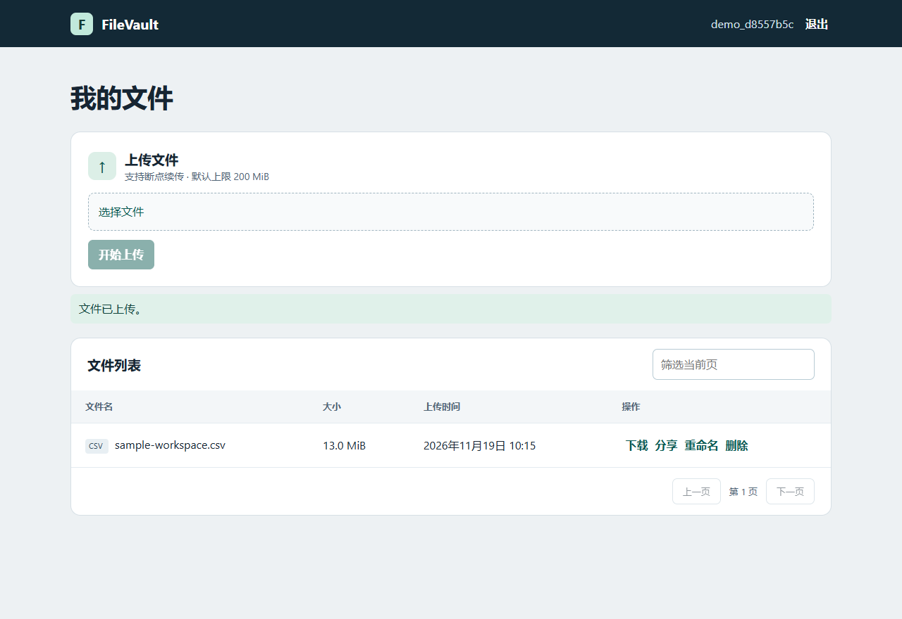

# FileVault

基于 Spring Boot 的大文件分片上传与安全共享管理平台。FileVault — Resumable File Upload & Secure Sharing Platform。

适用于本机或受控测试环境中的私人文件收集与临时交付。后端采用 Java 21、Spring Boot 4.1.2、Spring MVC、Spring Security、MyBatis 和 MySQL 8.4，Flyway 管理迁移。前端采用 Vue 3 与 TypeScript。

支持会话认证、账户隔离、文件分页管理、流式下载、重命名和软删除。小文件可通过 multipart API 上传，上限为 10 MiB。

浏览器使用 4 MiB 分片上传文件，暂停或刷新后可重新选择同一文件继续。服务端核对已登记分片的长度和 SHA-256，缺失或损坏的分片可用原始内容补传。整文件声明验证失败后，浏览器可重新开始。默认上传上限为 200 MiB，`FILEVAULT_MAX_UPLOAD_BYTES` 可设为 1 字节至 512 MiB 对应的字节数。

同一账户的已验证内容可复用物理对象。所有者可创建、查看和撤销有效分享，匿名接收方可下载附件。链接令牌在创建时返回，数据库保存其 SHA-256 摘要。

## 已实现的工程能力

- **事务与恢复**。在事务外完成网络暂存及顺序合并，在会话行锁下进行最终登记。中途失败可补传，并通过磁盘与 MySQL 对账定位异常。
- **索引与缓存**。按所有者和名称前缀跨页搜索，使用联合索引。当前用户的文件统计由 Spring Cache 与 Caffeine 缓存，文档记录真实执行计划与缓存加载次数。[MySQL 实验](docs/mysql-optimization.md)
- **后台任务**。定时生成只读存储巡检，有界线程池执行，MySQL 保存领取租约、退避、重试和结果。[可靠性与对账](docs/reliability.md)
- **访问和运维**。Session、CSRF、私有文件隔离、限时分享、单区间下载及入口限流。MDC 请求 ID 关联结构化日志，Actuator 与 Micrometer 提供受保护的指标。[运行日志与指标](docs/operations.md)

## Windows 原生运行

准备 JDK 21、MySQL 8.4、Node.js 24、npm、Git 和 PowerShell。构建使用 Maven Wrapper 3.9.11。Java 没有加入 PATH 时，在当前终端设置 `FILEVAULT_JAVA_HOME` 指向现有 JDK 根目录。

准备只绑定回环接口的 MySQL 实例。项目使用 `127.0.0.1:3308` 上的独立 `filevault_dev` 库和 `filevault_app` 账号。不要使用其他项目的库或管理员账号运行应用。参考 [数据库初始化](docs/database.md)。

在仓库根目录执行以下命令，并在本地配置文件中填写应用账号的生成密码。

```powershell
.\scripts\check-env.ps1
if (-not (Test-Path .env.local)) { Copy-Item .env.example .env.local }
notepad .env.local
.\scripts\start-local.ps1
```

打开浏览器访问 [本机 FileVault](http://127.0.0.1:8082)。只运行 API 时使用 `.\scripts\start-backend.ps1`。首次构建需要访问 Maven Central 和 npm 的包仓库。静态资源与私有文件应位于分离的目录。配置、资源限制和只读对账命令见 [可靠性文档](docs/reliability.md)。

## 演示和验证

注册并登录，在上传区选择一个大于 8 MiB 的 CSV 文件。等待第一片完成后暂停并刷新，重新选择同一文件继续。下载完成的文件，然后创建一个限时分享，在无痕窗口打开。回到原窗口重新打开分享管理并撤销链接，刷新无痕窗口可观察到链接失效。



在应用运行时另开一个 PowerShell 窗口执行健康检查。已安装 Chrome 时可运行完整浏览器验收。

```powershell
.\scripts\smoke-test.ps1
Push-Location frontend
npm.cmd test
npm.cmd run test:browser
Pop-Location
Push-Location backend
if ($env:FILEVAULT_JAVA_HOME) { $env:JAVA_HOME = $env:FILEVAULT_JAVA_HOME }
.\mvnw.cmd clean verify
Pop-Location
```

完整后端验收包含真实 MySQL 集成测试。环境变量与命令见 [测试文档](docs/tests.md)。

本机全量验收通过 42 项后端测试、6 项前端测试及 Chrome 流程。GitHub Actions 流程定义覆盖 Java 21 的无库构建和单元测试，以及 Node 24 安装、测试和生产构建。托管执行尚未验证。[CI 工作流](.github/workflows/ci.yml)

本机回环实测包含 190 MiB 单上传和双路 16 MiB 上传，六次下载全部通过 SHA-256 比对。[测量条件与结果](docs/benchmark.md)

## 已知限制

文件系统和数据库各自提交，异常退出仍可能留下需要对账的文件。缓存、限流和暂存预算面向单实例。公网部署、长期负载、分布式协调和完整对象备份恢复尚未验收。

## 开发文档

[架构](docs/architecture.md) · [数据库](docs/database.md) · [API](docs/api.md) · [安全](docs/security.md) · [测试](docs/tests.md) · [性能记录](docs/benchmark.md) · [里程碑](docs/milestones.md)

[可靠性与对账](docs/reliability.md) · [F5 安全审查](docs/security-audit.md) · [GitHub 发布清单](docs/github-release-checklist.md)

[简历项目描述](docs/resume/filevault-java-internship.md) · [技能证据](docs/resume/skills-evidence.md) · [后端面试指南](docs/interview/filevault-backend-guide.md)
