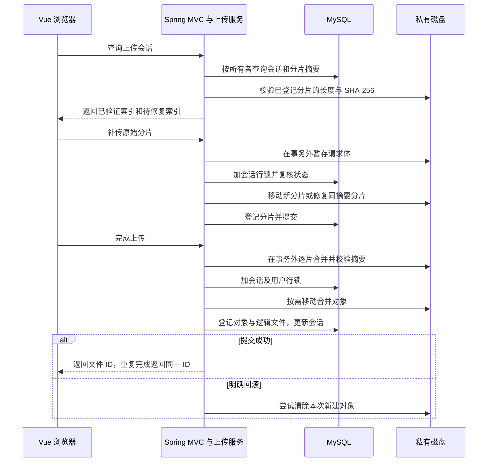

# 架构

FileVault 在 Windows 本机运行。Spring MVC 接收 REST 请求，MyBatis 处理数据库访问，Flyway 管理独立 MySQL 库的模式。健康检查区分进程存活与依赖可用。

认证模块管理 Spring Security 同源会话和 CSRF。文件模块管理逻辑文件记录及其对象引用。上传模块持久化会话与已接收索引，合并验证后由文件模块登记对象。分享模块独立管理令牌摘要、过期时间和撤销状态。

对象、分片和临时文件位于应用私有目录。静态资源仅映射 Vue 入口和 `/assets/**`，启用这些路由前，应用检查实际 web 根与私有根的真实路径。计划任务回收已关闭会话的分片。

Vue 生产构建由 Spring MVC 提供静态资源，同源访问 REST API。浏览器分段读取文件计算 SHA-256，以账号、文件名、大小和摘要定位本地保存的会话 ID，再向后端查询已接收的索引。进度按服务端确认的字节数更新。

文件系统和 MySQL 各自提交。进程退出或提交结果未知时，可用只读对账定位异常候选。详细顺序、资源限制和恢复边界见 [可靠性与对账](reliability.md)。
